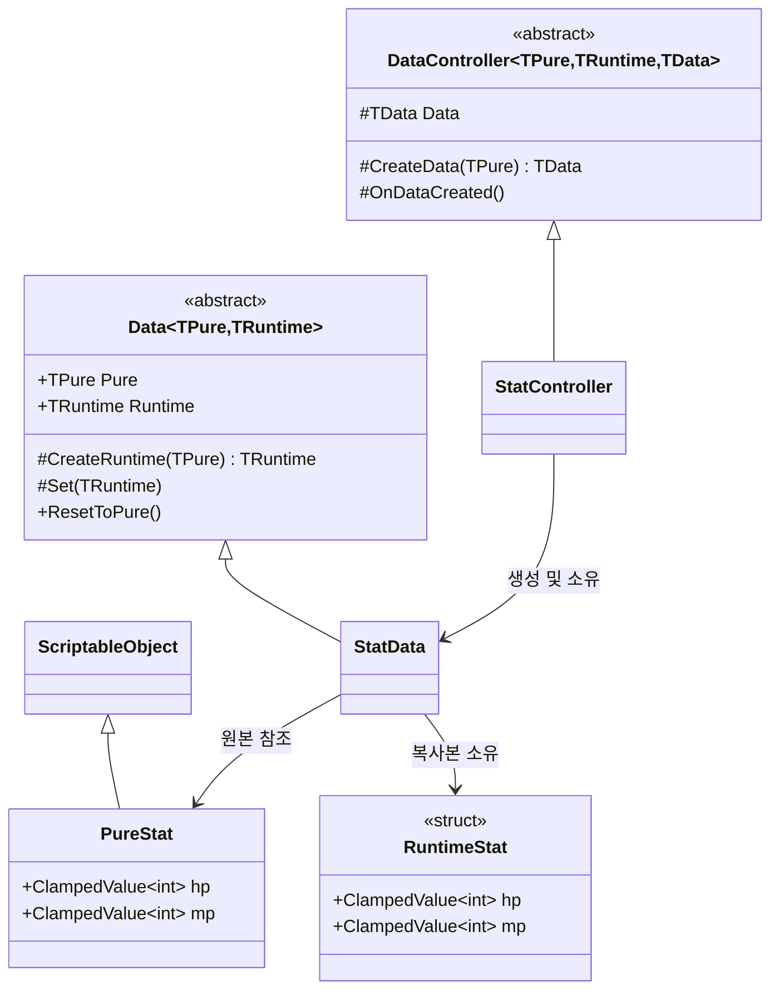

## 1. 개요

### 1.1. 모듈 소개
* **한 줄 요약**: 기획 데이터(불변)와 플레이 중 변하는 데이터(가변)를 타입 수준에서 분리하고, 언제든 원본 값으로 되돌릴 수 있게 묶어 주는 제네릭 데이터 구조입니다.
* **해결하려는 문제**: `ScriptableObject`의 값을 런타임에 직접 수정하면 에디터에서는 에셋 원본이 오염되고, 여러 오브젝트가 같은 에셋을 공유할 때 값이 서로 섞입니다. 또한 HP·MP처럼 범위가 정해진 값은 매번 `Mathf.Clamp`를 호출하는 코드가 흩어지기 쉽습니다.

### 1.2. 구성 요소
| 구성 요소 | 역할 |
| :--- | :--- |
| **`Pure` (ScriptableObject)** | 기획자가 인스펙터에서 편집하는 **불변 원본 값** |
| **`Runtime` (struct)** | 플레이 중 변하는 **가변 값**의 묶음 (값 타입으로 복사 보장) |
| **`Data<TPure, TRuntime>`** | Pure와 Runtime을 한 쌍으로 묶고, `ResetToPure()`로 초기화 지원 |
| **`DataController<TPure, TRuntime, TData>`** | MonoBehaviour에서 Data를 생성·소유하는 진입점 |
| **`ClampedValue<T>`** | 최소/최대 범위를 스스로 보장하는 불변 값 타입 |
| **`ISaveable`** | 저장/불러오기 대상 데이터의 공통 규격 |

---

## 2. 구조



* **흐름**: `DataController.Awake()` → `CreateData(pure)` → `Data` 생성자에서 `CreateRuntime(pure)` 호출 → Pure 값을 복사한 Runtime 생성.
* **데이터 방향**: Pure → Runtime으로만 흐르며, Runtime의 변경은 Pure에 절대 역류하지 않습니다.

---

## 3. 핵심 코드

### 3.1. Data&lt;TPure, TRuntime&gt; — 원본과 런타임 값의 한 쌍
```csharp
public abstract class Data<TPure, TRuntime>
    where TPure : ScriptableObject
    where TRuntime : struct
{
    private TRuntime m_runtime;

    public TPure Pure { get; }
    public TRuntime Runtime => m_runtime;

    protected Data(TPure pure)
    {
        Pure = pure;
        m_runtime = CreateRuntime(pure);
    }
    protected abstract TRuntime CreateRuntime(TPure pure);   // 도메인이 반드시 구현

    protected void Set(TRuntime next) => m_runtime = next;

    public void ResetToPure() => Set(CreateRuntime(Pure));
}
```
* **`TRuntime : struct` 제약**: `Runtime` 프로퍼티는 값을 **복사해서** 반환하므로, 외부에서 `Data.Runtime.hp = ...`처럼 내부 상태를 우회 수정할 수 없습니다. 값 변경은 하위 클래스의 `Set()`을 거쳐야만 합니다.
* **`ResetToPure()`**: 원본 에셋을 다시 읽어 Runtime을 재생성하므로, 리스폰·스테이지 재시작 같은 초기화 로직을 도메인마다 따로 작성할 필요가 없습니다.

### 3.2. ClampedValue&lt;T&gt; — 범위를 스스로 지키는 값
```csharp
[Serializable]
public struct ClampedValue<T> where T : IComparable<T>
{
    [SerializeField] private T value;
    [SerializeField] private T min;
    [SerializeField] private T max;

    public T Value => value;
    public bool IsMin => value.CompareTo(min) <= 0;
    public bool IsMax => value.CompareTo(max) >= 0;

    public ClampedValue(T value, T min, T max)
    {
        if (min.CompareTo(max) > 0)
            throw new ArgumentException($"min({min})이 max({max})보다 큽니다.");
        this.value = Clamp(value, min, max);
        this.min = min;
        this.max = max;
    }

    public ClampedValue<T> With(T next)
    {
        ClampedValue<T> copy = this;
        copy.value = Clamp(next, min, max);
        return copy;
    }
}
```
* **불변 갱신(`With`)**: 기존 값을 수정하지 않고 범위가 보정된 **새 값**을 반환합니다. 호출부는 `hp = hp.With(hp.Value - damage)` 한 줄로 끝나며, 범위 초과 버그가 원천적으로 발생하지 않습니다.
* **`IComparable<T>` 제약**: `int`, `float`뿐 아니라 비교 가능한 어떤 타입에도 동일하게 적용됩니다.
* **`[Serializable]` + `[SerializeField]`**: 인스펙터에서 value/min/max를 바로 편집할 수 있어 Pure 에셋의 필드로 그대로 사용됩니다.

### 3.3. DataController — MonoBehaviour 진입점
```csharp
public abstract class DataController<TPure, TRuntime, TData> : MonoBehaviour
    where TPure : ScriptableObject
    where TRuntime : struct
    where TData : Data<TPure, TRuntime>
{
    [SerializeField] private TPure pure;
    protected TData Data { get; private set; }

    protected virtual void Awake()
    {
        if (pure == null)
        {
            Debug.LogError($"{name}: {typeof(TPure).Name} 미지정", this);
            return;
        }

        Data = CreateData(pure);
        OnDataCreated();
    }

    protected abstract TData CreateData(TPure pure);
    protected virtual void OnDataCreated(){}
}
```
* **에셋 누락 방어**: Pure 에셋이 비어 있으면 어떤 오브젝트에서 누락됐는지 컨텍스트와 함께 로그를 남기고 초기화를 중단합니다.
* **`OnDataCreated()` 훅**: 하위 클래스는 Awake 순서를 신경 쓰지 않고, 데이터가 준비된 시점에 UI 바인딩 등을 연결할 수 있습니다.

---

## 4. 사용 예시 — 스탯 도메인 추가

새로운 도메인을 추가할 때 작성하는 코드는 **Pure, Runtime, Data, Controller 네 개의 짧은 선언**뿐입니다.

```csharp
// 1) 원본: 인스펙터에서 편집
[CreateAssetMenu(menuName = "Pure Data/Pure Stat")]
public class PureStat : ScriptableObject
{
    [SerializeField] private ClampedValue<int> HP;
    [SerializeField] private ClampedValue<int> MP;
    public ClampedValue<int> hp => HP;
    public ClampedValue<int> mp => MP;
}

// 2) 런타임 값 묶음
[Serializable]
public struct RuntimeStat
{
    public ClampedValue<int> hp;
    public ClampedValue<int> mp;
}

// 3) Pure → Runtime 복사 규칙만 정의
public class StatData : Data<PureStat, RuntimeStat>
{
    public StatData(PureStat pure) : base(pure) { }

    protected override RuntimeStat CreateRuntime(PureStat pure)
        => new RuntimeStat
        {
            hp = new ClampedValue<int>(pure.hp.Value, pure.hp.Min, pure.hp.Max),
            mp = new ClampedValue<int>(pure.mp.Value, pure.mp.Min, pure.mp.Max)
        };
}

// 4) 씬에 붙이는 컴포넌트
public class StatController : DataController<PureStat, RuntimeStat, StatData>
{
    protected override StatData CreateData(PureStat pure) => new StatData(pure);
}
```

---

## 5. 고민과 선택

| 고민 | 선택 | 근거 |
| :--- | :--- | :--- |
| 런타임 값을 어디에 둘 것인가 | ScriptableObject와 **분리된 struct** | SO를 직접 수정하면 에디터에서 에셋이 오염되고, 같은 에셋을 공유하는 오브젝트끼리 값이 섞임 |
| Runtime을 class로 할지 struct로 할지 | **struct** | getter가 복사본을 반환하므로 외부에서 내부 상태를 우회 변경할 수 없음 |
| 범위 보정 책임 | 값 타입 **`ClampedValue<T>`에 내장** | 호출부마다 `Clamp`를 반복하지 않아도 되고, 범위를 벗어난 값이 존재할 수 없는 상태를 보장 |
| 초기화 로직 | 베이스의 **`ResetToPure()`** 하나로 통일 | 도메인이 늘어나도 `CreateRuntime` 한 곳만 정의하면 생성과 초기화가 함께 해결됨 |
