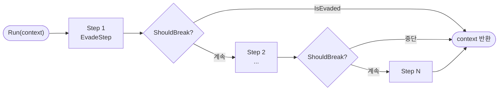

## 1. 개요

### 1.1. 모듈 소개
* **한 줄 요약**: 하나의 연산을 여러 개의 독립된 단계(Step)로 쪼개고, 그 단계의 **구성과 순서를 ScriptableObject 에셋에서 편집**할 수 있게 만든 제네릭 비동기 파이프라인입니다.
* **해결하려는 문제**: 데미지 계산처럼 "명중 → 회피 → 방어 → 치명타 → 최종 피해"로 이어지는 연산은 하나의 메서드에 `if` 분기로 쌓이기 쉽습니다. 단계를 추가하거나 순서를 바꿀 때마다 코드를 수정해야 하고, 연출(대기·애니메이션)을 중간에 끼우기도 어렵습니다.

### 1.2. 구성 요소
| 구성 요소 | 역할 |
| :--- | :--- |
| **`IPipeLineStep<T>`** | 컨텍스트를 받아 가공 후 돌려주는 **단일 단계** 규격 (`UniTask` 기반) |
| **`PipeLineSo<T>`** | 단계 목록을 순서대로 실행하는 **파이프라인 에셋** |
| **`ShouldBreak(T)`** | 단계마다 검사하는 **조기 종료 조건** (하위 클래스에서 정의) |
| **Context (`BaseDamageContext`)** | 단계 사이를 흐르는 **연산 상태 객체** |
| **`GenericPipeLineEditor`** | 모든 파이프라인 에셋에 자동 적용되는 **단계 편집 인스펙터** |

---

## 2. 실행 흐름



* 각 단계는 `await`로 순차 실행되므로, 단계 안에서 연출 대기(`UniTask.Delay`, 애니메이션 완료 대기 등)를 자연스럽게 끼워 넣을 수 있습니다.
* 단계가 끝날 때마다 `ShouldBreak`를 검사해, 회피처럼 이후 계산이 무의미해진 경우 즉시 파이프라인을 종료합니다.

---

## 3. 핵심 코드

### 3.1. 단계 규격과 파이프라인 에셋
```csharp
public interface IPipeLineStep<T>
{
    UniTask<T> Execute(T context);
}

public interface IPipeLine<T>
{
    UniTask<T> Run(T context);
}

/// 모든 파이프라인 에셋의 최상위 비제네릭 베이스 클래스입니다. (에디터 타겟용)
public abstract class PipeLineSoBase : ScriptableObject { }

public abstract class PipeLineSo<T> : PipeLineSoBase, IPipeLine<T>
{
    [SerializeReference]
    protected List<IPipeLineStep<T>> steps = new List<IPipeLineStep<T>>();

    public async UniTask<T> Run(T context)
    {
        if (steps == null) return context;

        foreach (var step in steps)
        {
            context = await step.Execute(context);

            // 각 단계 실행 후 중단 조건 체크
            if (ShouldBreak(context))
            {
                break;
            }
        }

        return context;
    }

    protected virtual bool ShouldBreak(T context) => false;
}
```
* **`[SerializeReference]`**: 인터페이스 타입 리스트에 서로 다른 구현 클래스를 **다형적으로 직렬화**합니다. 단계가 MonoBehaviour나 별도 에셋일 필요가 없어, 순수 C# 클래스만으로 단계를 만들 수 있습니다.
* **`PipeLineSoBase`**: Unity의 `[CustomEditor]`는 열린 제네릭 타입을 대상으로 지정할 수 없기 때문에, 비제네릭 베이스를 하나 두어 **모든 `PipeLineSo<T>`에 공용 에디터가 적용**되도록 했습니다.

### 3.2. 도메인 파이프라인 — 중단 조건만 정의
```csharp
[CreateAssetMenu(menuName = "Scriptable Objects/BaseDamagePipeLineSO")]
public class BaseDamagePipeLineSO : PipeLineSo<BaseDamageContext>
{
    protected override bool ShouldBreak(BaseDamageContext context)
    {
        if (context == null) return true;

        // 회피 발생 시 이후 데미지 계산 단계 무효화
        return context.IsEvaded;
    }
}
```
* 새로운 연산 도메인을 추가할 때는 **Context 클래스와 중단 조건**만 정의하면 실행 로직과 에디터는 그대로 재사용됩니다.

### 3.3. 단계 구현 예시 — 회피 판정
```csharp
public class EvadeStep : IPipeLineStep<BaseDamageContext>
{
    public UniTask<BaseDamageContext> Execute(BaseDamageContext context)
    {
        if (context == null) return UniTask.FromResult(context);

        float totalValue = context.AttackerAccuracy + context.VictimEvadeRate;

        // 예외 처리 (총합 0 이하 시 기본 공격 성공)
        if (totalValue <= 0f)
        {
            context.IsEvaded = false;
            return UniTask.FromResult(context);
        }

        // 무작위값 피격자 회피율 미만 시 회피 성공
        bool isEvaded = Random.Range(0f, totalValue) < context.VictimEvadeRate;

        context.IsEvaded = isEvaded;
        context.AttackFailed = isEvaded;

        return UniTask.FromResult(context);
    }
}
```
* **명중 vs 회피 비율 판정**: `명중 + 회피` 구간에서 난수를 뽑아 회피 구간에 들어오면 회피로 처리합니다. 두 수치의 합이 0 이하면 난수 구간 자체가 없으므로 먼저 걸러 기본 명중으로 처리합니다.
* **동기 단계의 비용 최소화**: 대기가 필요 없는 단계는 `UniTask.FromResult`로 즉시 반환해 불필요한 상태 머신 할당을 피합니다.

### 3.4. 공용 인스펙터 — 단계 자동 탐색
```csharp
[CustomEditor(typeof(PipeLineSoBase), true)]
public class GenericPipeLineEditor : UnityEditor.Editor
{
    private void OnEnable()
    {
        // 타겟 클래스 계층에서 PipeLineSo<T>의 T(Context) 타입을 추출
        contextType = GetPipeLineContextType(target.GetType());
        stepsProp = serializedObject.FindProperty("steps");
        reorderableList = new ReorderableList(serializedObject, stepsProp, true, true, true, true);

        reorderableList.onAddDropdownCallback = (buttonRect, list) =>
        {
            var menu = new GenericMenu();

            // IPipeLineStep<contextType>를 구현한 모든 클래스를 동적으로 검색
            Type stepInterfaceType = typeof(IPipeLineStep<>).MakeGenericType(contextType);
            var stepTypes = AppDomain.CurrentDomain.GetAssemblies()
                .SelectMany(s => s.GetTypes())
                .Where(p => stepInterfaceType.IsAssignableFrom(p) && !p.IsInterface && !p.IsAbstract);

            foreach (var type in stepTypes)
            {
                menu.AddItem(new GUIContent(type.Name), false, () =>
                {
                    serializedObject.Update();
                    int index = stepsProp.arraySize;
                    stepsProp.InsertArrayElementAtIndex(index);
                    stepsProp.GetArrayElementAtIndex(index).managedReferenceValue = Activator.CreateInstance(type);
                    serializedObject.ApplyModifiedProperties();
                });
            }
            menu.ShowAsContext();
        };
    }

    private Type GetPipeLineContextType(Type type)
    {
        while (type != null && type != typeof(ScriptableObject))
        {
            if (type.IsGenericType && type.GetGenericTypeDefinition() == typeof(PipeLineSo<>))
                return type.GetGenericArguments()[0];
            type = type.BaseType;
        }
        return null;
    }
}
```
* **Context 타입 역추적**: 에셋의 상속 계층을 거슬러 올라가 `PipeLineSo<T>`의 `T`를 찾아냅니다. 덕분에 파이프라인마다 별도 에디터를 작성하지 않아도 됩니다.
* **호환 단계만 노출**: `+` 버튼을 누르면 **해당 Context를 처리할 수 있는 단계만** 드롭다운에 표시되어, 데미지 파이프라인에 엉뚱한 타입의 단계를 넣는 실수를 막습니다.
* **ReorderableList**: 드래그로 단계 순서를 바꿀 수 있어, 계산 순서 조정이 코드 수정 없이 에셋 편집만으로 끝납니다.

---

## 4. 사용 예시

```csharp
public class Attacker : MonoBehaviour
{
    [SerializeField] private BaseDamagePipeLineSO damagePipeline;

    public async UniTask Attack(GameObject victim)
    {
        var context = new BaseDamageContext
        {
            Attacker = gameObject,
            Victim = victim,
            BaseDamage = 10,
            AttackerAccuracy = 0.9f,
            VictimEvadeRate = 0.1f,
        };

        context = await damagePipeline.Run(context);

        if (context.AttackFailed) return;   // 회피 등으로 공격 실패
        // context.BaseDamage 적용 ...
    }
}
```

---

## 5. 고민과 선택

| 고민 | 선택 | 근거 |
| :--- | :--- | :--- |
| 단계를 어떻게 저장할 것인가 | **`[SerializeReference]` + 순수 C# 클래스** | 단계마다 SO 에셋을 만들면 에셋 수가 폭증하고, MonoBehaviour는 씬에 종속됨 |
| 동기 vs 비동기 | **`UniTask<T>` 반환** | 연출 대기를 단계 안에 넣을 수 있고, 동기 단계는 `FromResult`로 할당 없이 처리 |
| 조기 종료 위치 | 파이프라인의 **`ShouldBreak`** | 각 단계가 "다음 단계를 실행할지"를 알 필요 없이, 도메인 규칙을 한 곳에서 관리 |
| 에디터 중복 | **비제네릭 베이스 + 리플렉션 기반 공용 에디터** | `[CustomEditor]`가 열린 제네릭을 지원하지 않는 제약을 우회하고, 새 파이프라인에도 자동 적용 |
