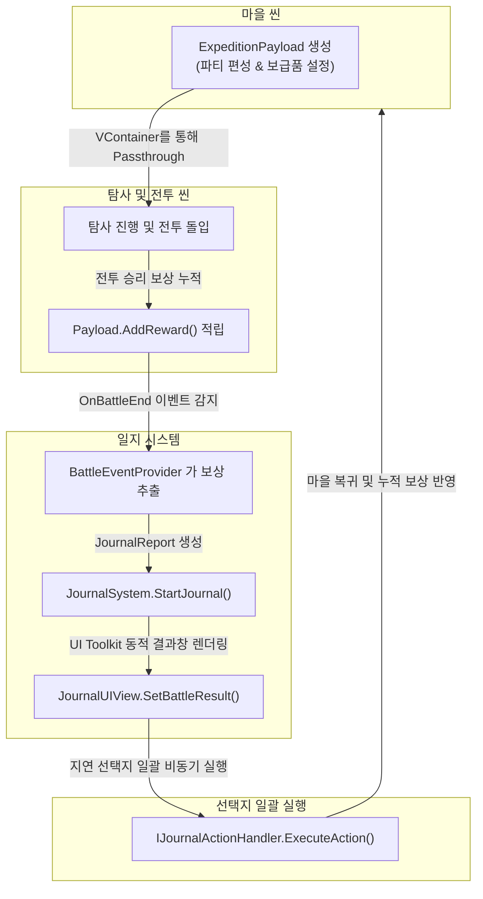
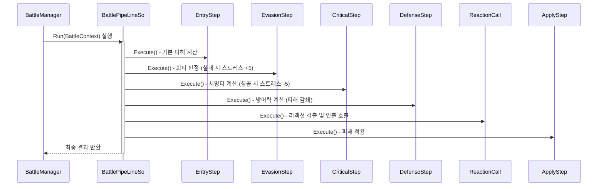

## 1. 개요 및 목차

### 1.1. 기술 구현 개요
* **핵심 구현**: 씬 전환 시 데이터 유실을 막는 전송 구조를 만들고, 전투 피해 연산 단계와 일지 선택지 결과를 차례로 처리하는 시스템을 개발했습니다.

### 1.2. 프로젝트 목차
| 장 번호 | 핵심 주제 | 구현 방식 및 기술 수단 |
| :--- | :--- | :--- |
| **2장** | 프로젝트 배경 및 범위 | VContainer 의존성 주입 스코프 및 씬 간 데이터 보존 범위 설정 |
| **3장** | 전체 시스템 아키텍처 | ExpeditionPayload 중심의 씬 순환 데이터 흐름 설계 |
| **4장** | 개발자 구현 명세 | 일지 지연, 전투 파이프라인, 캠핑 정비, Shapes 벡터 UI 구현 |
| **5장** | 팀장 주도 시스템 통합 | R&R 모니터링, 인터페이스 규격 표준화 및 무중단 게임 빌드 통합 |
| **6장** | 고민과 선택 : 결정 근거 | DI 컨테이너 전달 설계 및 비동기 일괄 병렬 처리 도입 근거 분석 |
| **7장** | 프로젝트 회고 | Addressable 리소스 로드 오류 해결 및 메모리 누수 방지 성과 |

---

## 2. 프로젝트 배경 및 범위

* **배경 및 범위**: 마을, 탐사, 전투 화면을 독립적으로 분할 개발할 때 발생하는 **데이터 유실**과 **연산 꼬임**을 차단하고자 **단일 데이터 전달 방식** 및 **단계별 연산기**를 구축하고, 안전한 데이터 연동과 결과창 출력을 목표로 설정했습니다.

---

## 3. 전체 시스템 아키텍처

마을에서 생성된 대원 정보가 탐사와 전투를 거쳐 보상을 획득하고, 다시 마을로 복귀하는 전체 데이터의 흐름도입니다.



---

## 4. 개발자 구현 명세

### 4.1. 일지 시스템
* **사용자 경험**:
  - 전투와 탐사가 끝나면 단순 결과창 대신 대장 시점의 **일지 형태**로 나타나 이야기를 감상하고 **하단 선택지**를 통해 모험 방향을 직접 결정할 수 있습니다.
  <div class="image-card-text hover-image" data-image="portfolio/project5/Image/JournalChoice.png, portfolio/project5/Image/JournalWin.png">
    <p>탐사 진행 도중 선택지를 결정하는 화면과 전투 승리 후 생성된 보고서 형태의 일지 화면 구현 예시입니다.</p>
  </div>

* **시스템 동작**:
  - 각 화면의 결과 데이터를 임시 저장소에 수집하고 즉각 수치를 변경하지 않습니다.
  - 최종 완료 전까지 유저가 언제든 이전 페이지로 이동해 선택지를 취소하고 번복할 수 있는 조작 편의성을 제공합니다.
  - 마지막에 일지를 닫는 순간 보류해 둔 선택 결과를 한꺼번에 일괄 반영하여 데이터가 꼬이는 충돌을 방지했습니다.

```csharp
// 지연 보류해 두었던 일지 선택 결과를 한꺼번에 일괄 병렬 실행하는 코어 루틴
private async UniTaskVoid ExecuteAllDeferredOptions()
{
    var tasks = new List<UniTask>();

1. 수집된 일지 목록을 순회하며 유저가 클릭한 옵션의 식별 키 추출
    foreach (var report in _model.Reports.ToArray())
    {
        if (report.SelectedOption.HasValue)
        {
            var opt = report.SelectedOption.Value;
            if (string.IsNullOrEmpty(opt.actionKey)) continue;

2. 식별 키와 일치하는 액션 처리자를 찾아 실행 태스크 등록
            foreach (var handler in _actionHandlers.ToArray())
            {
                if (handler.CanHandle(opt.actionKey))
                {
                    **tasks.Add(handler.ExecuteAction(opt.actionKey, report));**
                }
            }
        }
    }

3. 보류해 두었던 모든 액션 태스크가 끝날 때까지 병렬로 비동기 동기화 대기
    if (tasks.Count > 0)
    {
        **await UniTask.WhenAll(tasks);**
        Debug.Log($"[JournalSystem] 선택지 일괄 처리 완료 ({tasks.Count}건)");
    }
}
```

<br>

---

### 4.2. 전투 시스템 및 전투 파이프라인 연동
전투 행동 발생 시 **전투 파이프라인**을 연계하여 피해량 계산, 회피 판정, 감정 수치 변화 및 연쇄 리액션 공격을 정교하게 처리합니다.



* **사용자 경험**:
  <div class="image-card-text hover-image" data-image="portfolio/project5/Image/Reaction.mp4">
    <p>공격 회피 시 스트레스가 쌓이고 치명타 시 낮아지는 <strong>캐릭터 감정 변화</strong>와, 리액션 조건 만족 시 <strong>초상화 연출 팝업</strong> 후 자동으로 연쇄 타격을 개입하는 전투 흐름 시연 영상입니다.</p>
  </div>

* **시스템 동작**:
  - **전투 관리 모듈**이 턴제 전투의 시작 및 종료 루프 흐름을 제어합니다.
  - **전투 수치 연산기**는 데이터 에셋 기반으로 구축되어 전투 중 **연산 파이프라인 자체를 동적으로 교체**하는 유연한 아키텍처를 지닙니다.
  - 무조건 치명타가 발동하는 등의 특수 규칙이 필요한 상황 발생 시, 특정 단계가 추가되거나 생략된 **다른 파이프라인 에셋으로 스왑**하여 피해 계산을 수행합니다.

```csharp
1. 공격을 회피했거나 대상 유닛이 사망한 경우 더 이상의 피해 연산을 생략하고 즉시 차단
protected override bool ShouldBreak(BattleContext context)
{
    **return context.isEvaded || context.target.IsDead;**
}

2. 현재 전투 페이즈에 발동 자격을 갖춘 캐릭터들의 반격 액션 목록 추출 및 비동기 실행
public async UniTask<BattleContext> Execute(BattleContext context)
{
    if (context.target == null || reactionSystem == null) return context;

    IReadOnlyList<ReactionExecution> executions = reactionSystem.Resolve(context, Phase);

    foreach (ReactionExecution execution in executions)
    {
3. 반격 캐릭터의 초상화 컷신 연출이 끝날 때까지 화면 연동 비동기 대기
        if (portraitCanvas != null)
        {
            **await portraitCanvas.ShowAsync(execution.Agent.ImageAddress, execution.Result);**
        }

4. 연쇄 반격 연출을 실행하고 캐릭터별 라운드 반격 횟수 가산
        **await execution.Agent.ExecuteReaction(execution, context, reactionSystem.BattleManager);**
        execution.Agent.IncrementReactionCount();
    }
    return context;
}
```

---

### 4.3. 공용 파이프라인 시스템
* **개발적 시스템 장점**:
  - **독립된 구조**: 전투 시스템 외에 순차적인 연산이 요구되는 다양한 기능 영역에 동일하게 재사용할 수 있습니다.
  - **흐름 조율**: 중간에 연산 차단 조건을 설정하여 **불필요한 연산 흐름을 즉시 중단**할 수 있습니다.
* **시스템 동작**:
  - 전달받은 데이터를 정해진 단계별로 차례대로 통과시켜 **계산의 시작과 끝을 안전하게 보장**합니다.
  - 연산 실행 중 상대의 **공격 회피 성공**처럼 계산을 더 진행할 필요가 없는 중단 조건을 만족하면, **후속 계산 단계를 생략**하여 컴퓨터 자원 낭비를 예방했습니다.

```csharp
// 데이터를 순차 실행 단계에 통과시켜 계산의 시작과 완결을 안전하게 보장
public virtual async UniTask<T> Run(T context)
{
1. 등록된 연산 단계들을 차례대로 루프 실행
    foreach (var step in steps)
    {
2. 계산 도중 중단 조건(공격 회피 성공 등)을 만족하면 후속 연산을 취소하고 루프 탈출
        **if (ShouldBreak(context))**
        **{**
            **break;**
        **}**
3. 전달된 데이터를 다음 단계의 계산 결과로 갱신하여 연속 완결성 보장
        **context = await step.Execute(context);**
    }
    return context;
}
```

---

### 4.4. 캠핑 시스템
* **사용자 경험**:
  - 캠핑 화면에서 캐릭터들의 부상 및 스트레스를 확인하여 붕대나 진정제를 분배하며, 한정된 **생존 자원의 분배 의사결정**을 조작합니다.
* **시스템 동작**:
  - 캐릭터들의 실시간 체력 및 스트레스 수치를 전수 검사하여, 치료가 시급한 대상을 분류하고 **맞춤 정비 일지 옵션**을 동적으로 빌드합니다.
  - 유저 선택 결과를 버퍼에 보류한 뒤, 씬 퇴장 시점에 데이터를 **일괄 동기화 적용**하고 캠프 씬을 클린 언로드하도록 설계했습니다.

```csharp
// 캐릭터의 결핍 상태를 진단하여 실시간으로 정비용 일지 옵션을 빌드
public void GenerateCampingReport()
{
    _locationProvider.ClearBuffer();
    
1. 캐릭터들의 실시간 체력 결핍 상태와 정신력 소모 여부 전수 검사
    **bool hasBandageTarget = _payload.Party.Any(c => c.Stat.current_Hp < c.Stat.max_Hp);**
    **bool hasSedativeTarget = _payload.Party.Any(c => c.Insanity > 0);**

2. 부상 유닛이 존재하는 경우 치료용 붕대 정비 옵션을 선택지에 강제 추가
    if (hasBandageTarget)
    {
        var bandageOptions = BuildBandageOptions();
        **_locationProvider.SetDiscovery("EVT_CAMP_START", bandageOptions, "캠핑 정비 - 붕대 치료");**
    }
    
3. 정신력 소모 유닛이 존재하는 경우 회복용 진정제 옵션을 선택지에 강제 추가
    if (hasSedativeTarget)
    {
        var sedativeOptions = BuildSedativeOptions();
        **_locationProvider.SetDiscovery("EVT_CAMP_START", sedativeOptions, "캠핑 정비 - 정신력 회복");**
    }
    
4. 최종 수집된 정비 보고서들을 일지 관리자로 전송하여 연출 실행
    _journalSystem.CollectDailyLogs();
}
```

---

### 4.5. 전투 UI 및 벡터 그래픽스 최적화
* **사용자 경험**:
  <div class="image-card-text hover-image" data-image="portfolio/project5/Image/SlotBar.png">
    <p>아군 캐릭터의 실시간 체력 및 정신력 수치를 외곽선이 뭉개지지 않는 깔끔한 벡터 막대 형태로 확인하고, 활성화 유닛은 점멸하는 테두리를 통해 자신의 행동 차례임을 인지하는 화면 예시입니다.</p>
  </div>
* **시스템 동작**:
  - **상태 바 컴포넌트**는 캐릭터의 체력 및 정신 상태 비율에 맞게 색상을 대입하고, **사각형 출력 기능**을 사용해 위아래 2단 게이지 막대를 그립니다.
  - 자기 차례가 되었을 때 시간에 따른 보간 연산으로 테두리 투명도를 실시간 조절하여 점멸하는 효과를 구현했습니다.

```csharp
// 필드 정의: 체력 및 정신력 비율값과 색상 그라디언트 에셋
public float hpfillAmount = 1;
public float insfillAmount = 1;
public Gradient colorGradient1;
public Gradient colorGradient2;
public Color currentColor = Color.gray;
public float alpha = 1f;

// 화면 갱신 부하 없이 외곽선이 깨지지 않는 상태 게이지를 실시간 그리는 렌더링 루틴
public override void DrawPanelShapes(Rect rect, ImCanvasContext ctx)
{
1. 빌드 에셋 번들 변환 시 설정 참조가 누락되어 검게 변하는 현상을 방지하는 예외 대입
    if (colorGradient1 == null || colorGradient2 == null) {
        InitializeDefaultGradients();
    }

2. 초기 런타임 구동 시 직렬화 오류로 투명도가 0으로 초기화되는 오작동 강제 보정
    if (alpha <= 0.01f) alpha = 1f;

3. 라운드 처리된 검은색 상태 창 배경 사각형 및 테두리 렌더링
    **Draw.Rectangle(rect, 8f, new Color(0, 0, 0, alpha));**
    Color borderCol = currentColor;
    borderCol.a *= alpha;
    **Draw.RectangleBorder(rect, 3f, 8f, borderCol);**

4. 2단 상태 바 출력을 위한 안쪽 패널 간격 및 개별 바 높이 계산
            Rect innerRect = Inset(rect, 8);
            float spacing = 4f;
            float barHeight = (innerRect.height - spacing) / 2f;

5. 체력 비율에 따른 색상을 산출하고 위쪽 상태 게이지 바 출력
            Rect hpfillRect = innerRect;
            hpfillRect.y += barHeight + spacing;
            hpfillRect.height = barHeight;
            hpfillRect.width *= hpfillAmount;
            Color hpCol = colorGradient1.Evaluate(hpfillAmount);
            hpCol.a *= alpha;
            **Draw.Rectangle(hpfillRect, 4f, hpCol);**
            
6. 정신력 비율에 따른 색상을 산출하고 아래쪽 상태 게이지 바 출력
            Rect insfillRect = innerRect;
            insfillRect.height = barHeight;
            insfillRect.width *= insfillAmount;
            Color insCol = colorGradient2.Evaluate(insfillAmount);
            insCol.a *= alpha;
            **Draw.Rectangle(insfillRect, 4f, insCol);**
}
```

---

## 5. 팀장 주도 시스템 통합

### 5.1. 아키텍처 모니터링 및 코드 리뷰 가이드
* 팀원들의 진행 상황과 코드를 점검하여 서로 얽히는 현상을 막았습니다.
* 각자가 구현한 기능들이 합쳐질 지점을 미리 정해두고 가이드하여, 최종 통합 단계에서 연동 에러가 발생하지 않도록 예방했습니다.

### 5.2. 모듈 간 인터페이스 규격 표준화
* 개발 시작 전 각 기능 담당자가 외부로 노출할 public 메서드의 명칭과 데이터 형태를 사전에 논의하여 약속해 두고 구현을 시작했습니다.
* 이렇게 약속된 public 메서드의 연동 사양을 표준 규격으로 설정하여, 서로 다른 개발자가 만든 컴포넌트 간에 데이터를 입력하고 출력할 때 혼선이 생기지 않도록 방지했습니다.

### 5.3. 독립 모듈 간 데이터 흐름 조율 및 시스템 통합
* 5.2장에서 미리 정의하여 정해둔 public 메서드들을 유기적으로 결합하여 최종 시스템 통합을 완성했습니다.
* 지도 이동, 전투 결과 처리, 안내 모드 실행 등 각자 따로 제작한 독립 기능들을 사전에 약속한 public 메서드 호출 흐름으로 엮어내어, 끊김 없이 정상 가동되는 단일 게임 빌드로 통합했습니다.

---

## 6. 고민과 선택 : 데이터 모델 및 아키텍처 결정 근거

### 6.1. 고민 1: 씬 간 무중단 파티 데이터 수송
화면 전환 시 대원의 상태 정보 및 획득한 보상 데이터의 누락을 방지하고자 실제 데이터 컨테이너인 **ExpeditionPayload**를 활용한 공유 데이터 수송 구조 설계의 비교입니다.

| 대안 | 방식 | 장점 | 단점 |
| :--- | :--- | :--- | :--- |
| **대안 A: 전역 싱글톤 사용** | Unity의 `DontDestroyOnLoad` 기법을 적용한 단일 전역 관리자 클래스를 상시 유지 | 구현 구조가 단순하고 여러 씬에서 즉각 참조 및 접근이 쉬움 | 전역 상태 결합도를 상승시켜 독립 테스트가 어렵고 객체 수명 주기의 유연한 해제가 불가함 |
| **대안 B: 공유 컨테이너 주입** | VContainer 의존성 주입 스코프 내에 **ExpeditionPayload**를 DontDestroyOnLoad가 아닌 **Lifetime.Singleton**으로 등록하여 수동 주입 | 씬 전환 흐름과 데이터 수명이 연동되어 필요 시점에서 해제가 가능하고 결합이 완전히 해제됨 | 의존성 주입을 위한 보일러플레이트 코드가 증가하고 초기 설계 비용이 필요함 |

> **결정: 대안 B (공유 컨테이너 주입) 채택**
> 
> 프로젝트 사양 검토 결과 **대원의 생명 주기와 ExpeditionPayload의 수명 주기가 씬 흐름과 동일하게 엄격히 통제되어야 함**을 확인했습니다. 따라서 DontDestroyOnLoad가 아닌 VContainer의 **Lifetime.Singleton** 스코프 방식을 채택하여 객체 소멸 시점을 완전히 제어하고 메모리 누수를 원천 차단했습니다.

<sub style="color: gray;">* 주석 (보일러플레이트): 시스템 구동을 위해 최소한의 변경만으로 여러 곳에 중복 작성해야 하는 틀에 박힌 형식적 코드</sub>

### 6.2. 고민 2: 일지 선택지 지연 일괄 비동기 실행
일지 조작 시 대원의 선택 결과를 인게임 데이터에 반영하는 최적의 트랜잭션 시점 결정입니다.

| 대안 | 방식 | 장점 | 단점 |
| :--- | :--- | :--- | :--- |
| **대안 A: 클릭 시 즉시 데이터 변경** | 플레이어가 일지 옵션을 선택할 때마다 실시간으로 해당 데이터를 갱신하고 반영함 | 구현 구조가 직관적이며 즉각적인 수치 변화를 제공함 | 페이지 뒤로 가기를 통한 선택 번복이 차단되고, 연산 과정에서 중간 상태 꼬임 발생 가능성이 높음 |
| **대안 B: 닫기 시 지연 일괄 처리** | 유저 조작 결과를 임시 버퍼에 누적 보류한 뒤, 최종 페이지 닫기 시점에 비동기 병렬 실행 | 취소 및 페이지 복구가 안전하고, 병렬 처리를 통해 화면 멈춤을 예방함 | 중간 결과를 일시적으로 버퍼링해야 하는 임시 관리용 제어 코드가 소요됨 |

> **결정: 대안 B (닫기 시 지연 일괄 처리) 채택**
> 
> 플레이어가 **결정을 최종 확정하기 전까지 안전하게 선택을 철회하거나 페이지를 넘나들 수 있는 편의성을 확보**하고, 일괄 비동기 처리를 통해 연산 안정성을 높이기 위해 대안 B를 채택했습니다.

---

## 7. 프로젝트 회고

### 7.1. 트러블 슈팅 및 문제 해결

#### 1) 리소스 로드 세팅 누락으로 인한 널 반환 중단 버그 해결
* **문제 상황**: 전투 도중 캐릭터 각성 컷신을 호출하기 위해 이미지 자원을 비동기 참조할 때, 간헐적으로 설정 유실로 인해 널 객체가 반환되어 **게임이 일시적으로 중단되는 오류**가 발생했습니다.
* **원인 분석**: 팀 협업 과정에서 메타 설정 파일이 유실되거나, 이미지가 로딩되는 도중에 갑작스러운 씬 변경으로 자원 해제가 요청되어 연쇄 충돌이 유발되었습니다.
* **해결 방안**: 자원 로딩 시작부와 로딩 진행 완료 시점에 **2단계 널 검사 안정성 확인 단계**를 이식하고, 시각 연출이 완결되면 로드된 자원을 순차 반환하도록 정리 코드를 심어 복구했습니다.

#### 2) 퇴각 처리 및 화면 전환 시 이벤트 잔존으로 인한 메모리 누수 방지
* **문제 상황 및 배경**: 전투를 중도에 포기하거나 다른 화면으로 전환할 때, 보상 리포트 발행자가 전투 관리 컴포넌트의 이벤트를 계속 붙잡고 있어 **가비지 컬렉션 처리가 차단되고 누수가 발생하는 현상**이 있었습니다.
* **해결 방안**: 보상 발행자 클래스에 **명시적 연결 해제 인터페이스**를 구현하여, 화면이 소멸하거나 컴포넌트가 파괴될 때 구독 관계를 완벽히 단절해 메모리가 안전하게 자동 정리되도록 개선했습니다.

### 7.2. 결과 및 수행 회고

* **성능 및 연동 최적화 성과**:
  - 화면에 직접 다각형을 직접 그리는 **즉시 렌더링 방식**을 활용해 캐릭터 상태 바를 개발함으로써, 캔버스 구조의 드로우콜을 절감하고 해상도 변화에 영향받지 않는 깨끗한 UI 외곽 렌더링 품질을 확보했습니다.
