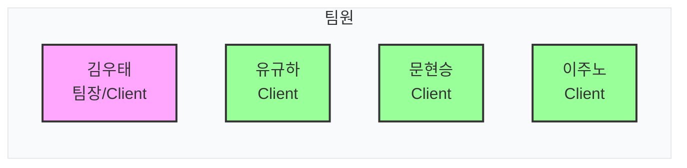

## 1. 개요 및 목차

### 1.1. 프로젝트 정의
* **프로젝트 정의**: 역할군 의무와 고유 성향이 전투 데이터로 충돌 및 연계되는 1인 조종 + 3인 자동 리액션 기반의 턴제 전술 로그라이크 팀 프로젝트입니다.
### 1.2. 프로젝트 목차
| 장 번호 | 핵심 주제 | 상세 설계 내용 |
| :--- | :--- | :--- |
| **2장** | 팀원 구성 및 역할 | 개발진 구성 및 협업 R&R 정의 |
| **3장** | 프로젝트 동기 및 협업 배경 | 서사형 시스템 구현 기획 및 개발자 간 연동 필요성 수립 |
| **4장** | 기획 및 시스템 설계 핵심 | 인장 책임자 서사, 코어 루프 및 타겟 유저층 분석 |
| **5장** | 상세 시스템 및 코드 매칭 | 일지, 리액션, 파이프라인, 캠핑, UI 기획 요구사항 및 구현 매칭 |
| **6장** | 기획 문서 정량 명세 | 단독 기획서 13종 상세 목록 수립 |

---

## 2. 팀원 구성 및 역할

본 프로젝트는 총 4인의 개발진으로 구성되었으며, 역할 분담 하에 유기적인 협업을 거쳐 타이틀을 완성했습니다.

---

## 3. 프로젝트 동기 및 협업 배경

* **프로젝트 동기 및 배경**: 기존 RPG의 단조로운 영웅 서사 구조에서 벗어나, '역할은 의무를 만들고, 성향은 변수를 만든다'는 전술 로그라이크 기획 모토 하에 대원의 성향 및 결핍 상태가 실제 전투 리액션과 탐사 연쇄 반응으로 유기적으로 작동하는 게임 시스템을 구현하고자 했습니다.
* **협업 배경**: 지도 생성, 전투 이동, 수치 연산 등 개별 기능을 개발자 각자가 분담하여 개발하는 과정 중 데이터 유실을 방지하고 매끄러운 턴 전환을 보장하기 위해 사전 연동 규격을 표준화하는 가이드가 요구되었습니다.

---

## 4. 기획 및 시스템 설계 핵심

### 4.1. 기획 의도 및 레퍼런스
* **영웅 서사 탈피**: 플레이어는 위대한 영웅이 아닌 왕실 공식 인장(보급 서명 수단)을 쥐었을 뿐인 실리적 관리자(인장 책임자)에 불과하며, 대원들의 갈등과 본능을 운용하는 인적 자원 관리 서사를 지향했습니다.
* **행동을 통한 성격 증명**: 캐릭터 성향(겁쟁이, 이기주의 등)을 대사나 텍스트 묘사가 아닌, 전장에서 발동하는 전투 리액션 실시간 데이터 및 물리 행동으로 직접 입증하고자 했습니다.
* **레퍼런스 게임**:
  * **다키스트 던전(Darkest Dungeon)**: 스트레스 임계 압박 및 가혹한 상태 결핍 관리를 모사했습니다.
  * **슬레이 더 스파이어(Slay the Spire)**: 빌드 최적화 및 연쇄 리액션 덱 설계의 지적 쾌감을 지향했습니다.

### 4.2. 코어 루프 (Core Loop)
* **마을/캠프 정비** ➡️ **개척지 탐사** ➡️ **턴제 전투** ➡️ **보상 누적 및 귀환** ➡️ **캠핑 정비** 순환 구조를 가집니다.
* **캠핑/일지 피드백**: 전투 행동 데이터와 스트레스 변화를 리더의 건조한 보고서 일지로 변환하여 플레이어 선택지로 서사를 환류했습니다.

### 4.3. 타겟 유저층 분석
* **핵심 타겟 (Core Target)**: 최적화 빌드 설계와 다단계 턴제 연산을 선호하는 하드코어 전략/전술 게임 유저층입니다.
* **확장 타겟 (Sub Target)**: 로그라이크 덱 빌더 장르 매니아, 대원들의 성향 갈등 및 내러티브 서사에 몰입하는 스토리 지향 유저층입니다.

---

## 5. 상세 시스템 및 코드 스크립트 매칭

### 5.1. 일지 시스템
* **기획 요구사항**:
  - 정비 완료 혹은 전투 승리 시 모험 결과를 리더 관점의 서사적 일지 형태로 확인하고 넘길 수 있어야 합니다.
  - 일지 내 선택지를 결정하더라도 창을 완전히 닫기 전까지는 데이터에 즉시 반영되지 않으며, 최종 페이지를 닫는 순간 그동안 내린 결정 결과가 일시에 게임에 적용되어야 합니다.
* **실제 구현 코드 매칭**:
  * **매칭 클래스**: [JournalSystem.cs](file:///C:/Users/kot77/Desktop/GitPortfolio/portfolio/project5/Release%20Document/DEV.md#L118-L168)
  * **핵심 메소드**: `ExecuteAllDeferredOptions()`
  * **코드 구현 방식**: 
    * `IJournalActionHandler` 인터페이스 기반 핸들러 목록을 수집하여 처리 가능한 `actionKey` 검색.
    * 수집된 개별 비동기 태스크들을 `UniTask.WhenAll(tasks)`로 병렬 처리하여 대기 후 일괄 완료 보장.

### 5.2. 리액션 시스템
* **기획 요구사항**:
  - 전투 도중 아군의 공격이 회피당하면 공격한 대원의 스트레스 수치가 즉각 누적되어야 합니다.
  - 특정 상황(예: 아군 피격 등)에 맞춰 설정된 조건이 만족되면, 즉각 컷신 연출이 팝업된 후 연쇄 개입 리액션 스킬이 자동으로 실행되어야 합니다.
* **실제 구현 코드 매칭**:
  * **매칭 클래스**: `ReactionSystem.cs`, `ReactionDefinitionSO.cs` (리액션 해결 엔진 및 정의 DB) / [BattlePipeLineSo.cs](file:///C:/Users/kot77/Desktop/GitPortfolio/portfolio/project5/Release%20Document/DEV.md#L230-L284) (트리거 브릿지)
  * **핵심 메소드**: `ReactionSystem.Resolve()`, `ReactionCall.Execute()`
  * **코드 구현 방식**:
    * `BattlePipeLineSo`의 `ReactionCall` 단계가 리액션 트리거 신호를 인계하면, `ReactionSystem`이 `ReactionDefinitionSO`에 기재된 조건(역할 의무 조건 및 성향 본능 조건)을 전수 판정하여 매칭 대상 유닛의 리액션 행동을 연쇄적으로 실행함.
    * `BattlePipeLineSo` 내 `EvasionStep`에서는 공격 회피 시 시전자의 스트레스 수치를 즉각 가산(`IncreaseInsanity(5)`)하는 등 기획된 감정 변화 데이터 연동 처리.

### 5.3. 파이프라인 시스템
* **기획 요구사항**:
  - 데미지 계산 시 [기본 데미지 산출 ➡️ 회피 판정 ➡️ 치명타 계산 ➡️ 방어력 감쇄] 단계가 순서대로 연산되어 최종 반영되어야 합니다.
  - 연산 도중 공격이 회피되면 뒤이은 계산 단계를 즉시 차단하고 최종 피해 수치를 0으로 확정 반환해야 합니다.
* **실제 구현 코드 매칭**:
  * **매칭 클래스**: [PipeLineSO.cs](file:///C:/Users/kot77/Desktop/GitPortfolio/portfolio/project5/Release%20Document/DEV.md#L305-L330)
  * **핵심 메소드**: `PipeLineSo<T>.Run()`
  * **코드 구현 방식**:
    * 등록된 연산 Step들을 순회하며 실행하되, `ShouldBreak` 만족 시 실행 루프를 조기 중단하여 흐름 제어.

### 5.4. 캠핑 시스템
* **기획 요구사항**:
  - 캠핑 진입 시 대원들의 잔존 체력 및 스트레스 수치를 진단합니다.
  - 상태가 악화된 대원에게 한정된 자원(붕대, 진정제)을 분배 치료하는 선택지 옵션이 리더에게 제공되어 일지 시스템을 통해 직접 조작할 수 있어야 합니다.
* **실제 구현 코드 매칭**:
  * **매칭 클래스**: [CampingSystem.cs](file:///C:/Users/kot77/Desktop/GitPortfolio/portfolio/project5/Release%20Document/DEV.md#L343-L379)
  * **핵심 메소드**: `GenerateCampingReport()`
  * **코드 구현 방식**:
    * 파티원의 HP 결핍 및 스트레스 누적 여부를 LINQ로 검사하여 치료 및 진정 정비 일지 옵션을 동적으로 발행.

### 5.5. UI 시스템
* **기획 요구사항**:
  - 전투 완료 시 획득한 보상 카드를 화면에 노출합니다.
  - 생존 대원 카드 내 체력 및 스트레스 게이지바가 각 대원의 실제 잔존 수치 비율에 비례하여 동적으로 차오르도록 표현해야 합니다.
* **실제 구현 코드 매칭**:
  * **매칭 클래스**: [JournalUIView.cs](file:///C:/Users/kot77/Desktop/GitPortfolio/portfolio/project5/Release%20Document/DEV.md#L390-L422) / `ExpeditionPayload.cs`
  * **핵심 메소드**: `JournalUIView.SetBattleResult()`
  * **코드 구현 방식**:
    * UI Toolkit `VisualElement`와 `Length.Percent` 스타일시트 비율 연동을 사용해 동적으로 게이지 바 길이를 제어했습니다.

---

## 6. 기획 문서 정량 명세
* **기획 문서 총 13개 파일 **에 대해 단독 설계 및 상세 명세 수립을 완료했습니다.
* **00. Concept**: 세계관 및 게임 디자인 방향성 기획 1종.
* **01. System**: 개요, 기획서, 캐릭터 요소, 인공지능 AI, UIUX 전투 시스템, 캠핑 시스템, 전투 시스템, 이벤트 시스템, 사운드 VFX, 튜토리얼 작동 기획 등 시스템 상세 설계서 10종.
* **WorkGuide**: 개발 협업 룰 및 태스크 카드 포맷 가이드 2종.

 

